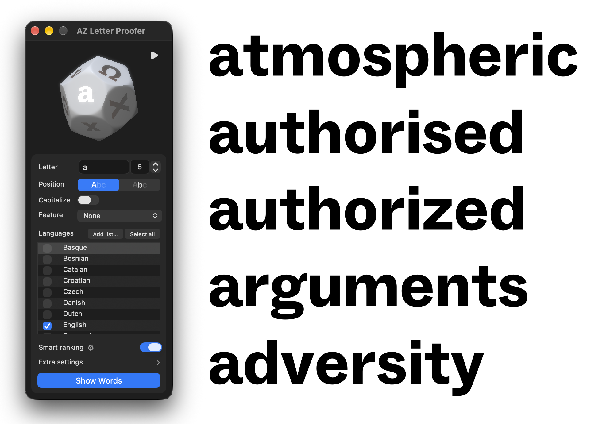
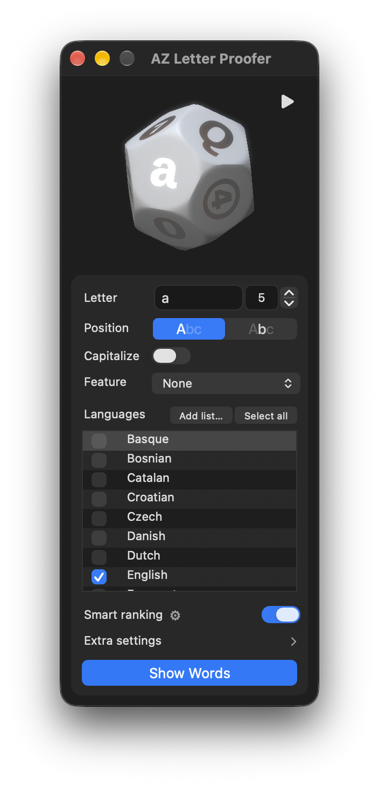

  

<h1 align="center">AZ Letter Digger</h1>

  <strong>Find optimal words to proof a specific letter.</strong>

  <a><picture>
    <source media="(prefers-color-scheme: dark)" srcset="https://img.shields.io/badge/Free_Plugin-6690e3">
    
  </picture></a>
  <a href="https://azerty-typefaces.com"><picture>
    <source media="(prefers-color-scheme: dark)" srcset="https://img.shields.io/badge/More_AZ_plugins-242424">
    
  </picture></a>

---

   

AZ Letter Digger is a [GlyphsApp](https://glyphsapp.com/) plugin that finds the words to proof a letter with. Where [word-o-mat](https://github.com/ninastoessinger/word-o-mat) picks random words that match, AZ Letter Digger ranks them. Turn **Smart ranking** off to get random words instead.

 

## Getting started

1. Install AZ Letter Digger with the link for your Glyphs version:
   - **Glyphs 3:** [Install in Glyphs 3](https://azerty-typefaces.github.io/AZ-LetterDigger/install.html?v=3)
   - **Glyphs 4:** [Install in Glyphs 4](https://azerty-typefaces.github.io/AZ-LetterDigger/install.html?v=4)

   Or open *Window ▸ Plugin Manager*, find **AZ Letter Digger** and click *Install*.
2. Restart Glyphs.
3. Open a font, then *Window ▸ AZ Toolkit ▸ Letter Digger*.  

> Coming from AZ Letter Proofer 0.1? The plugin was renamed: delete `AZ-LetterProofer.glyphsPlugin` from your Glyphs Plugins folder, then restart Glyphs.

 

## The window

   

| Control | Does |
| --- | --- |
| **Letter** | The letter to proof: the character itself, or its glyph name (`eacute`, `/eacute`, `uni00E9`). Separate several with spaces (`g k`, `eacute b`) to find words holding them all. While the window is active and no field is being edited, typing a letter puts it here, no need to click the field first. Leave it empty to proof the glyph you are editing, or every glyph of a selection (spaces and line breaks are skipped) |
| **Word count** | The number at the end of the Letter row: how many words to find, 1 – 10. Set it with the arrows next to it |
| **Position** | Words that start with the letter, or words that contain it anywhere |
| **Capitalize** | Capitalized words that still show your letter: a lowercase b gets "Abbey", never "Bank". Off, the case follows your letter: a lowercase letter gets lowercase words, an uppercase letter UPPERCASE words |
| **Feature** | Steers the ranking toward a construction group, or toward the glyphs carrying one of your tags. See below |
| **Languages** | The wordlists to search. Only the languages whose alphabet has your letter are listed; your ticks on the others are kept. **Clear all** unticks every language, **Select all** ticks them again. **macOS Dictionary** (the system's English word list) sits at the end, unticked until you tick it. **Add list…** adds your own word list, a `.txt` file with one word per line: put the most important words first, or use an alphabetical list and it gets shuffled. A new pick replaces the previous one |
| **Smart ranking** | On, the default: ranks the words and shows the best ones to proof with. Off: random words that fit your settings, like word-o-mat |
| **⚙** | Next to Smart ranking. Opens the scoring options, see below |
| **Extra settings** | Click to unfold the switches below it, and again to fold them away. Folded at first; the window remembers which |
| **Split lines** | One word per line in the tab, instead of one running line |
| **Use current tab** | Replaces the text of the current Edit tab instead of opening a new one |
| **No repeated letter** | Keeps only words in which no letter appears twice |
| **All letters in each word** | For several letters. On, the default: every word holds all of them. Off: words holding as many of them as possible, the most first. Greyed out for a single letter |
| **Show Words** | Opens the words in an Edit tab. Greyed out while there is nothing to proof |

Words are 3 to 11 letters long. Every setting is remembered between sessions.

 

## Feature

| Option | Does |
| --- | --- |
| **None** | Plain ranking |
| **Ascender, Bowl, Crossbar…** | A construction group from AZ Letter Digger's built-in letter ratings. Words built from that group's letters rank higher |
| **Tag: …** | One entry per tag on your font's glyphs. See *Proofing several glyphs* |

The Feature you pick also decides which glyphs fill the other faces of the dice.

 

## Proofing several glyphs

Type several letters or glyph names in the Letter field, separated by spaces, or leave it empty and select several glyphs in the Edit view, for example part of a word. **Show Words** then finds words holding every one of them, and the dice lights one face per glyph. Mixing cases gives Capitalized words, so both show: H and a give "Hand". The more glyphs you select, the fewer words hold them all. When none does, a message says so: turn off **All letters in each word** to get the words holding as many of them as possible instead.

Pick a **Tag:** entry in Feature to proof every encoded glyph carrying that tag. Here each glyph gets its own words. A glyph that no word can reach gets classic spacing strings instead: `nnXnn ooXoo` for a lowercase glyph, `HHXHH OOXOO` for an uppercase one.

 

## Scoring options

Click **⚙** next to Smart ranking. The options open on the right of the window.

<!-- SHOT 2 · PNG of the ⚙ popover open on the right: the Smart ranking explanation on top,
     then the four sliders, each with its grey hint line above. -->

The sliders only steer **Smart ranking**, so they are greyed out while it is off.

The sliders start at 0, which leaves them out of the ranking. They go from −2 to +2.

| Option | Does |
| --- | --- |
| **Diversity** | Rewards words that mix many construction groups: ascenders, bowls, terminals… Below 0, favours words that stay within a few |
| **Letter frequency** | Rewards words that hold your letter more than once. Below 0, pushes them down |
| **Marks frequency** | For a letter with an accent, rewards words with more accents |
| **Texture** | Rewards the most common letter pairs of the ticked languages. Below 0, favours unusual pairs |

 

## Requirements

- **Glyphs 3 or Glyphs 4.** Docking the window into the sidebar needs Glyphs 4 and AZ Docker; everything else works in both.
- **macOS 11 Big Sur or later.**
- **Python 3.10 or later** as Glyphs' Python.

 

## Feedback

Bugs and ideas go to the [issue tracker](https://github.com/azerty-typefaces/AZ-LetterDigger/issues).

 

## Credits

Copyright © 2026 [Hugo Jourdan](https://azerty-typefaces.com).

- The idea comes from [word-o-mat](https://github.com/ninastoessinger/word-o-mat) by Nina Stössinger, ported to Glyphs by Georg Seifert.
- Wordlists: [FrequencyWords](https://github.com/hermitdave/FrequencyWords) (OpenSubtitles 2018), filtered to alphabetic words of 3 – 11 letters and cut to the most frequent ones.
- Language alphabets: [Hyperglot](https://github.com/rosettatype/hyperglot) by Rosetta (Apache 2.0).

Made possible with the GlyphsSDK by Georg Seifert (@schriftgestalt) and Rainer Erich Scheichelbauer (@mekkablue).

 

## Licence

The code is under the MIT licence. The bundled wordlists are derived from FrequencyWords and stay under [CC BY-SA 4.0](https://creativecommons.org/licenses/by-sa/4.0/). See [LICENSE](LICENSE) for both.
